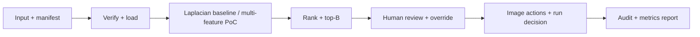

# Team 6 · T02 Raw QC Triage

Hoàng Trọng Trà – 2A202603342 chịu trách nhiệm tích hợp và tiếp quản phần việc còn lại theo yêu cầu trong chat.
Repo: https://github.com/trahoangdev/K5-Day6-L2B-HoangTrongTra-2A202603342-DataGovernanceAndPrivacy.
Đối chiếu BTC main `b0ce8bf`. Hồ sơ hiện tại cho thấy pipeline hoạt động, **chưa chứng minh chất lượng heldout**.
Freeze ghi nhận 2026-11-14T14:24:33+00:00, base `ff579c6`. Chưa có bằng chứng mốc phút 30/180 hoặc deadline +24h.
Group ID: **G06**. Tag `demo-180m` và `final-24h`: chưa chốt; deadline lớp: chưa được cung cấp.
Khi chốt bản nộp, tag `final-24h` cần trỏ đúng commit được nộp với timestamp thực tế, không backdate hoặc suy diễn đã đúng hạn.

## 1. Vấn đề và đầu ra

Người kiểm dữ liệu chỉ có budget B=20 để tìm ảnh cần chụp lại trước khi dùng downstream.
Bỏ sót blur, thiếu sáng hoặc lóa có thể làm dữ liệu không hữu ích; báo nhầm ảnh đêm làm mất dữ liệu hữu ích và tốn công thu thập.
Đầu vào là ảnh cùng metadata camera/light/split và manifest. Đầu ra gồm ranking, queue, action từng ảnh,
contact sheet offline, override/audit và quyết định có owner/reason.



Policy `t02-lead-v1` ưu tiên HOLD khi còn review hoặc thiếu provenance/offline; REWORK khi đã giải quyết review nhưng còn RECAPTURE;
GO khi tất cả ảnh KEEP và review bắt buộc đã có bằng chứng. GO chỉ mô tả triage của batch, không phải chứng nhận chất lượng hay tuân thủ pháp lý.

## 2. Dữ liệu và provenance

Fixture synthetic CC0-1.0 do BTC cung cấp: 96 ảnh, 56 dev và 40 eval, 24 scene gốc, bốn biến thể mỗi scene.
Split theo scene không rò scene giữa dev/eval. Schema `image_id,path,camera_id,light,split`; nhãn nội bộ thêm
`defect_type,severity,is_defect,annotator,source,note`. Mapping lỗi: blur/glare/dark/compression=1, none=0.
Manifest hash kiểm trên byte gốc, `.gitattributes` giữ fixture verbatim để tránh LF/CRLF làm sai checksum.
Toàn bộ 14 manifest fixture PASS; log còn gồm các manifest dữ liệu thật cục bộ, số lượng có thể khác khi clone sạch.

Nhãn nội bộ cuối chỉ gồm 56 dev, 34 ảnh lỗi, 22 ảnh none.
Hưng thực hiện một lượt và test-retest có hỗ trợ tiền gán nhãn AI, không phải hai annotator độc lập.
Agreement binary .900, kappa .800, type agreement .850 trên 20 retest là số liệu lịch sử của Data;
4 bất đồng đã adjudicate, giữ nguyên raw/retest/disagreement. img_18_3 có hồ sơ adjudication riêng, ghi actor AI-assisted,
không suy diễn thành review độc lập. Nhãn chịu thiên lệch cùng đặc trưng blur nên kết quả dev có thể lạc quan.
Không có GT eval chính thức trong student repo, không tạo hoặc suy luận GT cho 40 eval để tune.

## 3. Phương pháp và protocol

Baseline của Dương dùng variance Laplacian toàn ảnh, score âm để ảnh mờ xếp trước; action threshold 186.855.
Giữ giá trị đã triển khai, chưa có log grid-search để chứng minh tối ưu. Ngưỡng 777 trong ghi chú Data chỉ là minh họa tách nhãn sau quan sát,
khác ngưỡng triển khai và khác Recall@20.

PoC của Hạ kết hợp sharpness tile 4×4, p95/dark fraction, vùng sáng bão hòa sau erosion và tỉ lệ gradient biên JPEG 8×8.
Chuẩn camera/global học từ dev; so sánh session theo batch không dùng nhãn. Đây là phương pháp phụ thuộc thành phần batch,
không nên diễn giải là bộ phân loại từng ảnh độc lập. Với camera lạ/singleton, dùng fallback dev.
Weighted score cộng agreement bonus, higher nghĩa đáng ngờ hơn; score không giới hạn ở 1.
KEEP dưới .20, REVIEW từ .20 đến dưới .60, RECAPTURE từ .60.
Mọi tham số nằm trong `configs/submission.yaml`, SHA-256 ở `configs/protocol_freeze.json`; script từ chối nếu đầu vào freeze bị đổi.

Baseline/PoC dùng cùng pool, seed42, B=20, cấu hình policy và evaluator nguyên gốc.
Metric join theo image_id, lọc split trước top-B. Queue demo top-20 toàn bộ 96 khác top-20 dev hoặc eval.
Baseline threshold chỉ tác động action, ranking vẫn dùng score liên tục.
Không có weights/model cần tải lúc chạy. Thay đổi thuật toán sau báo cáo cần freeze mới và không được chọn theo eval.

## 4. Kết quả nội bộ và failure cases

**Chỉ đánh giá dev in-sample, nhãn AI-assisted. Không phải điểm BTC hay heldout.**
Số liệu dưới đây do `src.evaluate --split dev --budget 20` và `src.compare` sinh nguyên bản.
Ghi chú `eval N` của evaluator dùng tên chung, split thực tế ở JSON là dev.

Baseline: `baseline_internal_dev` (git 24807f8, seed 42) · PoC: `poc_internal_dev` (git 24807f8, seed 42)

| Metric (unit) | Slice | Baseline | PoC | Δ abs | Δ rel | Better | N |
|---|---|---|---|---|---|---|---|
| **Defect Recall@B** (GT defects in top-B / GT defects) | all | 0.5882 | 0.5882 | 0.0000 | +0.0% | higher | 56 |
| Precision@B (GT defects in top-B / B) | all | 1.0000 | 1.0000 | 0.0000 | +0.0% | higher | 56 |
| Defect-type accuracy (GT defects) (fraction) | all | 0.2647 | 0.9412 | 0.6765 | +255.6% | higher | 34 |
| False alarm in top-B (clean images in top-B / clean images) | light=day | 0.0000 | 0.0000 | 0.0000 | baseline=0 | lower | 36 |
| False alarm in top-B (clean images in top-B / clean images) | light=dusk | 0.0000 | 0.0000 | 0.0000 | baseline=0 | lower | 16 |
| False alarm in top-B (clean images in top-B / clean images) | light=night | 0.0000 | 0.0000 | 0.0000 | baseline=0 | lower | 4 |
| Runtime / 100 items (s) | all | 0.4068 | 0.8693 | | | lower | |


Cả hai chạm trần Recall@20 khả thi trên dev này: 20/34 vì số lỗi thật lớn hơn budget.
Không có cải thiện primary metric. Type accuracy cao hơn chỉ là secondary trên cùng nhãn dev.
PoC đổi ưu tiên từ blur sang glare/dark, không thể suy ra tốt hơn mọi camera hoặc mọi use case.
Các hit dưới đây dùng cùng top-20 dev toàn cục; N là số ảnh slice, lỗi thật là denominator recall.

| Slice | N | Lỗi thật | Hit Baseline | Hit PoC |
|---|---:|---:|---:|---:|
| light=day | 36 | 21 | 14 | 14 |
| light=dusk | 16 | 10 | 5 | 5 |
| light=night | 4 | 3 | 1 | 1 |
| camera_id=cam_A | 36 | 19 | 8 | 12 |
| camera_id=cam_B | 20 | 15 | 12 | 8 |
| defect_type=blur | 15 | 15 | 13 | 7 |
| defect_type=compression | 9 | 9 | 2 | 3 |
| defect_type=dark | 6 | 6 | 5 | 6 |
| defect_type=glare | 4 | 4 | 0 | 4 |
| defect_type=none | 22 | 0 | 0 | 0 |

Failure 1: `img_20_3` glare vẫn có nhiều cạnh nên global Laplacian không đưa vào top-20 dev;
PoC ưu tiên glare tốt hơn ở slice này. Xem `reports/images/hard_1_glare.png` và raw predictions.
Failure 2: `img_18_3` blur nặng được Baseline chọn nhưng PoC score 1.0 bị các ảnh nhiều cue đẩy ra khỏi top-20 dev.
Đây là lỗi phân bổ budget/ranking, không chỉ lỗi nhận dạng loại defect. `img_22_1` blur nội bộ còn có PoC score 0,
minh họa độ nhạy của nhãn nhẹ và session reference. Không chỉnh ngưỡng sau khi thấy các lỗi này.
Failure 3 theo handout: chưa chứng minh camera B mềm hơn có hệ thống. Trung vị trộn corruption gây kết luận sai;
Data đã đính chính bằng ảnh sạch theo scene, tránh dựng failure không có bằng chứng.

Wilson 95% mô tả Recall: 0.4222–0.7363;
Precision: 0.8389–1.0000.
Tương quan frame, chọn top-B và tune dev vi phạm giả định độc lập; các khoảng này không chứng minh tổng quát hóa hoặc chênh lệch có ý nghĩa.
Runtime đo một lần, gồm load/provenance/features/HTML/audit, không gồm startup process; không phải benchmark tối ưu.
Máy: Intel64 Family 6 Model 154 Stepping 3, GenuineIntel, Windows-11-10.0.26200-SP0, Python 3.12.14, code `24807f8`.

## 5. Human review và quyết định

Trà đã xác nhận trong chat: “Tôi đã xem và chấp thuận RECAPTURE cả 20 ảnh”.
`reports/review_queue.csv` giữ reviewer, timestamp và lý do riêng từng ảnh; `review_confirmation.json` ghi nguyên văn phạm vi xác nhận.
AI đưa đề xuất thị giác trước, Trà chấp thuận sau khi xem. Không coi đây là đánh giá mù hoặc annotator thứ hai.
Pipeline áp approve trên đề xuất RECAPTURE, không sửa score, metadata hay thứ hạng.
`reports/submission/poc/audit_log.jsonl` lưu bằng chứng review gốc; CSV review cũ sai context bị chặn.
Snapshot review đã công bố được giữ nguyên khi replay. Decision log chuẩn ở `reports/decision_log.csv`, chỉ append run mới.

Trước review: 0 reviewed, 25 pending, HOLD.
Sau review: 20 reviewed, 40 KEEP, 51 RECAPTURE,
5 pending, quyết định **HOLD / REVIEW_PENDING**.
Pending ngoài budget: img_15_0, img_09_0, img_16_3, img_08_2, img_19_2. Không tự tăng B để đổi HOLD thành GO.
Muốn xử lý tiếp cần protocol/run review bổ sung hoặc thu thập lại, tách khỏi phép chấm B=20.
GO/REWORK/HOLD đều có test; không dùng test synthetic như review evidence thật.

## 6. Kiểm tra OOD, reliability và tái lập

Theo plan freeze, dùng sampler BTC tải 10 ảnh BDD100K từ mirror `dgural/bdd100k`, seed42, max-side640.
Sampler ưu tiên rare/fog nên cả 10 ảnh đều foggy: {"daytime": 5, "night": 4, "dawn/dusk": 1}.
Đây là smoke test OOD có chủ đích, không đại diện phân phối thật. 56 ảnh dev giữ nguyên làm reference,
camera/session BDD chưa biết nên mỗi ảnh là singleton với fallback dev, không gộp session giả.
Run offline trả đủ 10 score hữu hạn, khoảng 1.050000–2.200744;
đề xuất {"RECAPTURE": 10}, loại {"glare": 8, "dark": 2}.
Không có QC GT nên không biết bao nhiêu báo nhầm. Toàn bộ bị RECAPTURE cho thấy cần human calibration/domain review,
không chứng minh model phát hiện đúng lỗi. Resize/JPEG chất lượng90 có thể đổi blockiness; không tune sau kiểm tra.
Ảnh/contact sheet thật ở `data/real/` gitignored; chỉ metadata/score/hash được đưa vào report.
Nguồn mirror và điều kiện research/education được ghi theo prep BTC; cần kiểm lại quyền sử dụng ngoài bài lab.

Kiểm tra hiện tại: **146 passed, 39 skipped, 0 failed**, preflight exit0, manifest exit0.
Các test skip cần GT overlay giảng viên. Kết quả pytest đã lưu ở `reports/submission/tests.txt`;
report đọc kết quả đã ghi nhận này, không đòi JUnit XML cục bộ và không coi việc sinh report là chạy test mới.
Log preflight/manifest và output chi tiết của từng lần chạy nằm trong `out/`, không đưa vào Git.
QA lịch sử của Hùng trên Windows từng có 16 lỗi checksum, 118 pass và 39 skip tại 081fae2;
đây là bằng chứng môi trường cũ, không xóa lịch sử hoặc coi là lỗi test hiện tại. Checkout giữ byte LF đã khắc phục.

```powershell
# Sau khi cài requirements.txt vào .venv (bước chuẩn bị, có thể cần mạng):
.venv/Scripts/python.exe -m tools.prepare_submission --replay-confirmed-review
.venv/Scripts/python.exe -m src.evaluate --track t02 --config configs/submission.yaml --gt reports/submission/internal_dev_labels_joined.csv --pred out/submission/poc/ranked_review.csv --split dev --budget 20
.venv/Scripts/python.exe -m pytest -q
# Khi giảng viên có GT: thay --gt bằng fixture GT, --split eval; không tune trên kết quả.
# OOD chỉ sau prep online, ảnh thật giữ local:
.venv/Scripts/python.exe -m tools.check_t02_ood
```

## 7. Giới hạn và đóng góp

Synthetic nhỏ, dev có bias tiền gán nhãn, night dev ít, cam_A/night không có dev để chuẩn theo camera×light.
Chưa có official GT/hidden eval, kiểm thử độc lập, đo usability hoặc run chứng minh thời hạn.
Khi tăng dữ liệu 10× cần đo lại CPU/memory/contact-sheet size và công suất reviewer, không ngoại suy từ một timing.
Ảnh thật có thể có người/biển số; không xuất pixel ra cloud/repo. Không tuyên bố đạt GDPR hay luật Việt Nam từ policy tự động.
Domain owner cần xác nhận mức hữu ích của ảnh và tiêu chí recapture; quyền chia sẻ/retention cần bên sở hữu dữ liệu xác nhận.

| Thành viên | Git author / email thực tế | Công việc | Commit chứng minh |
|---|---|---|---|
| Hoàng Trọng Trà – 2A202603342 | Hoang Trong Tra trahoangdev@gmail.com | Lead / Integrator; tiếp quản phần còn lại | 52b3cf1 |
| Nguyễn Quốc Hưng – 2A202603324 | Soraxolo sora.12082004@gmail.com | Data & Provenance | bd0850f |
| Phạm Văn Dương – 2A202603332 | pvd2201 pvd2201@gmail.com | Baseline & Research | 684924a |
| Nguyễn Nhật Hạ – 2A202603325 | Nguyen Ha hgnguyen47347714@gmail.com | Core Algorithm / PoC | e75920f |
| Lê Trần Phi Hùng – 2A202603353 | LTPhiHung phihung15032001@gmail.com | QA & Evaluation | 081fae2 |
| Nguyễn Tuấn Minh – 2A202603349 | Chưa có  | Human Review & Demo (phân công ban đầu) | Chưa có |

User đã giao Trà làm toàn bộ phần còn lại. Giữ nguyên ghi nhận đóng góp trước đó, không tạo commit giả cho Minh.
Yêu cầu BTC mỗi người có commit thực chất **chưa đủ cho người thứ sáu**; Trà tiếp quản không tự thay thế điều kiện cá nhân này.
AI hỗ trợ code công cụ hồ sơ, phân tích và soạn report/demo; mọi review được ghi đúng actor.

## 8. References và trạng thái nộp

Nguồn truy cập 2026-11-14:

- [BTC T02](https://github.com/VinUni-AI20k/K5-Day6-L2-DataGovernanceAndPrivacy/blob/main/docs/tracks/T02.md): metric, budget, baseline và failure analysis.
- [OpenCV Laplace Operator](https://docs.opencv.org/4.13.0/d5/db5/tutorial_laplace_operator.html): cơ sở đạo hàm bậc hai để đo chi tiết; code nhóm dùng SciPy, không sao chép demo C++.
- [SciPy binary_erosion](https://docs.scipy.org/doc/scipy/reference/generated/scipy.ndimage.binary_erosion.html): giải thích erosion của mask; việc phân biệt đèn/lóa là heuristic riêng cần kiểm chứng.
- [BDD prep BTC](../tools/download_real_samples.py) và [mirror](https://huggingface.co/datasets/dgural/bdd100k): sampler/provenance của OOD, không phải QC GT.

Đã có pipeline, metric contract, bảng sinh script, slice/CI, review thật, audit, test, OOD và source demo.
Còn giới hạn nộp: official score do giảng viên chấm, bằng chứng commit thành viên thứ sáu,
tag/thời hạn lịch sử chưa xác minh và batch hiện tại vẫn HOLD. Không báo các mục này là hoàn tất.
