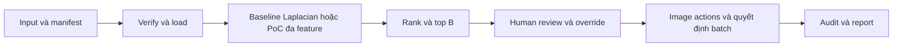

# Group Report — Day 06 Data Lab (Field-to-Release PoC)

> Điền đầy đủ, cụ thể, không viết chung chung. Mọi con số phải lấy từ file do script sinh ra
> (`reports/metrics_*.json`, `reports/table1_baseline_vs_poc.md`) — không gõ tay, không làm tròn mất đơn vị.
> 3–5 trang (hoặc README + report.md tương đương).

## 00 · Header

| Mục | Giá trị |
|---|---|
| Group ID | G06 · Team 6 |
| Challenge | T02 · Raw QC Triage |
| Thành viên (5–6) + vai trò | Hoàng Trọng Trà – 2A202603342 (Lead / Integrator); Nguyễn Quốc Hưng – 2A202603324 (Data & Provenance); Phạm Văn Dương – 2A202603332 (Baseline & Research); Nguyễn Nhật Hạ – 2A202603325 (Core Algorithm / PoC); Lê Trần Phi Hùng – 2A202603353 (QA & Evaluation); Nguyễn Tuấn Minh – 2A202603349 (Human Review & Demo) |
| Git URL | https://github.com/trahoangdev/K5-Day6-L2B-HoangTrongTra-2A202603342-DataGovernanceAndPrivacy |
| Tag `demo-180m` (commit) | [demo-180m](https://github.com/trahoangdev/K5-Day6-L2B-HoangTrongTra-2A202603342-DataGovernanceAndPrivacy/tree/demo-180m), annotated tag tại `22a7967ae3e3e6f1be400a5cfe29cdd02f1f938c`, tạo 14/11/2026 23:36:16 UTC+7. Giữ nguyên snapshot demo; tạo sau mốc 16:00 nên không chứng minh freeze đúng phút 180. |
| Tag `final-24h` (commit) | [final-24h](https://github.com/trahoangdev/K5-Day6-L2B-HoangTrongTra-2A202603342-DataGovernanceAndPrivacy/tree/final-24h), annotated tag được chốt lại sau `22a7967` để giữ README gốc và đồng bộ bằng chứng đóng góp. Tra commit bằng `git rev-parse final-24h^{commit}`, thời điểm thực tế bằng `git show --no-patch final-24h`; tag demo giữ nguyên ở snapshot trước. |
| Deadline (giờ VN) | **15/11/2026 11:59 (UTC+7)**, theo Trà cung cấp ngày 14/11/2026. Bắt đầu 14/11/2026 13:00; mốc 180 phút là 16:00 cùng ngày. Dùng hạn cụ thể này, không suy ra deadline từ thời điểm commit hoặc tên tag. |

README giữ nguyên guideline BTC theo yêu cầu của nhóm. Link repo, tag và deadline đặt tại mục 00 của report này; điều kiện đặt link ngay trong README của checklist BTC được ghi là chưa thực hiện ở Bảng 3. Chốt tag không thay thế bằng chứng commit cá nhân, showcase hoặc điểm hidden eval.

## 01 · Problem statement

- Ai bị ảnh hưởng / ai chịu hậu quả khi hệ thống sai? Người kiểm dữ liệu và bên dùng dữ liệu downstream. Bỏ sót ảnh lỗi làm giảm dữ liệu hữu ích; báo nhầm làm mất ảnh tốt và tốn công chụp lại.
- Điểm nghẽn cụ thể: budget chỉ B=20, cần ưu tiên ảnh nghi lỗi thay vì kiểm toàn bộ 96 ảnh.
- Đầu vào → đầu ra: ảnh + camera/light/split + manifest → score/ranking, queue, contact sheet, KEEP/RECAPTURE, audit và GO/HOLD/REWORK có reason/owner.
- Tiêu chí GO / HOLD / REWORK: policy `t02-lead-v1` ưu tiên HOLD nếu còn review hoặc thiếu provenance/offline; REWORK nếu review đã giải quyết nhưng còn RECAPTURE; GO nếu mọi ảnh KEEP và mọi review bắt buộc có bằng chứng. GO chỉ mô tả triage batch.
- Giả định cần xác nhận: domain owner xác định ảnh còn hữu ích hay cần chụp lại; bên sở hữu dữ liệu xác nhận quyền sử dụng và chia sẻ ảnh thật. Không dùng metric dev làm chứng nhận release.

## 02 · Data & provenance

| Split | N | Nguồn / link | License | Synthetic? |
|---|---|---|---|---|
| dev | 56 ảnh, 14 scene | [Fixture T02](../fixtures/t02_raw_qc/images.csv); [nhãn dev nội bộ](internal_labels_t02_final.csv) | Fixture CC0-1.0; nhãn do nhóm gán cho bài lab | Có |
| eval | 40 ảnh, 10 scene | Cùng fixture, split gốc; không có GT trong student repo | CC0-1.0 cho fixture | Có |
| heldout chính thức | Chưa được cung cấp N | BTC giữ private hidden eval, nhóm chưa đánh giá | Theo gói giảng viên; chưa có thông tin riêng | Do BTC cung cấp |

- Schema & class mapping: `image_id,path,camera_id,light,split`; nhãn thêm `defect_type,severity,is_defect,annotator,source,note`. Blur/glare/dark/compression → is_defect=1, none → 0. Severity 0/1/2 là nhẹ/vừa/nặng. Bộ nhãn dev có 34 ảnh lỗi và 22 ảnh none.
- Seed: 42. Chia dev/eval theo scene gốc, không để các biến thể cùng scene xuất hiện ở hai split.
- `manifest.csv` verified (sha256): có; `python -m tools.verify_manifests` xác nhận 14/14 fixture manifests. Giữ byte fixture bằng `.gitattributes` để tránh LF/CRLF làm sai hash.
- Dữ liệu thật: 10 ảnh BDD100K từ mirror `dgural/bdd100k`, sampler BTC seed 42, max-side640, đều foggy do ưu tiên rare case. Không có QC GT, chỉ smoke test offline. Ảnh/contact sheet thật ở `data/real/` gitignored. BDD license được ghi theo prep BTC cho nghiên cứu/học tập; không suy diễn quyền sử dụng ngoài lớp.
- Nhãn nội bộ có AI hỗ trợ tiền gán nhãn, một annotator cùng test-retest, không phải hai người độc lập. Giữ [hồ sơ adjudication img_18_3](adjudication_img_18_3.json); raw lịch sử còn trong Git. Nhãn và checksum đã freeze, không dùng nhãn eval để tune.

## 03 · Research & design

- 2–3 references và lý do chọn: OpenCV Laplace Operator giải thích tín hiệu đạo hàm bậc hai; SciPy binary_erosion hỗ trợ xử lý vùng sáng; đề T02 của BTC xác định budget, baseline và failure modes. URL/ngày xem ở mục 11.
- Sơ đồ data flow:



- Thành phần offline: Python/NumPy/Pillow/SciPy, không có pretrained model/weights cần download. Cấu hình và hash nguồn ở `configs/lab.yaml`, `configs/protocol_freeze.json`.
- Trade-offs: global Laplacian đơn giản nhưng bỏ qua glare cục bộ và cạnh JPEG giả. PoC dùng tile sharpness, brightness/dark fraction, eroded glare blobs và biên JPEG. Chuẩn camera/global chỉ fit dev; session reference không dùng nhãn nhưng phụ thuộc batch. Nhiều cue giúp ưu tiên glare/dark, có thể đẩy blur khỏi budget.

## 04 · Baseline vs PoC

- Baseline: `src/team06/baseline.py`, variance Laplacian toàn ảnh, score âm; một ngưỡng hành động 186.855. Nguồn triển khai `684924a`; config hiện tại `configs/lab.yaml`.
- PoC: `src/team06/features.py`, `src/team06/scoring.py`, nguồn `e75920f`, tích hợp/guard `b6ed356`. Score cộng trọng số blur/dark/glare/compression và agreement bonus; high score = review trước.
- Cùng budget / heldout / seed: cùng B=20, seed 42, pool fixture và policy. **Bảng đang chấm cùng 56 dev nội bộ, không phải heldout**; chưa có official GT. JSON đo tại git `24bf3ec`, thuật toán được ràng buộc bằng freeze hash.

**Bảng 1 · Baseline vs PoC & hard slices** — số liệu lấy từ JSON do evaluator sinh; [bảng đầy đủ](table1_baseline_vs_poc.md) do `python -m src.compare reports/metrics_baseline.json reports/metrics_poc.json` xuất.

| Metric (unit) | Baseline | PoC | Δ & chú thích |
|---|---|---|---|
| Primary: Defect Recall@B (fraction) | 0.5882 (20/34) | 0.5882 (20/34) | Δ = 0.0000; higher; N=56 |
| Precision@B (fraction) | 1.0000 (20/20) | 1.0000 (20/20) | Δ = 0.0000; higher; B=20 |
| Defect-type accuracy (GT defects) | 0.2647 | 0.9412 | Δ = 0.6765; higher; N=34 |
| Hard-slice: false alarm in top-B, night | 0/1 = 0.0000 | 0/1 = 0.0000 | lower; N=4 ảnh, chỉ 1 ảnh sạch; baseline=0 |
| Review@B / miss / FP (ảnh, dev) | 20 / 14 / 0 | 20 / 14 / 0 | B=20; miss = lỗi thật ngoài top-B; FP = ảnh sạch trong top-B |
| Runtime / 100 items (s) | 0.4189 | 0.8497 | lower; đo một lần trên 96 ảnh, gồm pipeline; không gồm startup process |

Cả hai chạm trần Recall@20 trên dev này: 20/34. Primary không tăng; type accuracy là secondary trên cùng nhãn dev có bias, không chứng minh tổng quát hóa.

## 05 · Evaluation protocol

- Công thức primary, đơn vị và denominator: image; Defect Recall@B = TP trong top-B / tổng ảnh lỗi thật; Precision@B = TP / số ảnh chọn. Trên dev, cả hai có TP=20, FP=0, FN=14. Xem [metric contract](metric_contract.md).
- Threshold/budget/thời điểm: B=20, seed 42; Baseline=186.855; PoC KEEP dưới 0.20, REVIEW từ 0.20 đến dưới 0.60, RECAPTURE từ 0.60; đầy đủ trọng số trong config. Freeze ghi nhận 14/11/2026 21:24:33 UTC+7. Đây là ghi nhận muộn sau phát triển trên dev, không chứng minh đã chốt ở phút 30.
- Độ bất định: Wilson 95% mô tả Recall 0.4222–0.7363, Precision 0.8389–1.0000. Frame cùng scene, chọn top-B và tune dev vi phạm giả định độc lập; không dùng khoảng này để tuyên bố hiệu quả heldout hoặc ý nghĩa thống kê của chênh lệch.
- Lệnh evaluate dev chính xác, sau lệnh prepare ở mục 08:

```bash
python -m src.evaluate --track t02 --config configs/lab.yaml --gt out/submission/internal_dev_labels_joined.csv --pred out/submission/poc/ranked_review.csv --split dev --budget 20 --run-name poc_internal_dev --out reports/metrics_poc.json
```

Official/hidden eval do giảng viên cung cấp input/GT và chạy evaluator split eval. Nhóm giữ nguyên metric, không đọc GT trong pipeline và không tune sau khi xem eval.

## 06 · Result slices

| Slice | N | Baseline | PoC | Ghi chú |
|---|---|---|---|---|
| light=day | 36 | 14/21 = 0.6667 | 14/21 = 0.6667 | Recall trong cùng top-20 dev; denominator=21 lỗi thật |
| light=dusk | 16 | 5/10 = 0.5000 | 5/10 = 0.5000 | Recall trong cùng top-20 dev; denominator=10 lỗi thật |
| light=night | 4 | 1/3 = 0.3333 | 1/3 = 0.3333 | Recall trong cùng top-20 dev; denominator=3 lỗi thật |
| camera_id=cam_A | 36 | 8/19 = 0.4211 | 12/19 = 0.6316 | Recall trong cùng top-20 dev; denominator=19 lỗi thật |
| camera_id=cam_B | 20 | 12/15 = 0.8000 | 8/15 = 0.5333 | Recall trong cùng top-20 dev; denominator=15 lỗi thật |
| defect_type=blur | 15 | 13/15 = 0.8667 | 7/15 = 0.4667 | Recall trong cùng top-20 dev; denominator=15 lỗi thật |
| defect_type=compression | 9 | 2/9 = 0.2222 | 3/9 = 0.3333 | Recall trong cùng top-20 dev; denominator=9 lỗi thật |
| defect_type=dark | 6 | 5/6 = 0.8333 | 6/6 = 1.0000 | Recall trong cùng top-20 dev; denominator=6 lỗi thật |
| defect_type=glare | 4 | 0/4 = 0.0000 | 4/4 = 1.0000 | Recall trong cùng top-20 dev; denominator=4 lỗi thật |

- Các slice dùng cùng top-20 dev toàn cục, không cấp lại B=20 cho từng slice. Bảng lấy từ `out/submission/slices.csv` do script sinh.
- Failure case 1: [img_20_3](../fixtures/t02_raw_qc/images/img_20_3.jpg), glare cục bộ trên ảnh nhiều cạnh. Baseline bỏ khỏi top-20 dev; PoC chọn nhờ glare cue.
- Failure case 2: [img_18_3](../fixtures/t02_raw_qc/images/img_18_3.jpg), blur nặng; Baseline chọn nhưng PoC score 1.0 bị ảnh nhiều cue đẩy khỏi top-20 dev. Đây là hạn chế ranking/budget, không chỉnh ngưỡng để sửa số sau đánh giá.
- Hard negative bắt buộc: [img_18_1](../fixtures/t02_raw_qc/images/img_18_1.jpg) là ảnh đêm hữu ích, PoC giữ. Chưa chứng minh cam_B mềm hơn có hệ thống; trung vị trộn corruption không đủ để kết luận khác biệt quang học.
- Latency/compute: Intel64 Family 6 Model 154 Stepping 3, GenuineIntel; Windows-11-10.0.26200-SP0; Python 3.12.14. Baseline 4.1885 ms/ảnh, PoC 8.4969 ms/ảnh trên 96 ảnh. Đây là timing một lần của pipeline, không gồm process startup.

## 07 · Human & decision

- Review queue: [review_queue.csv](review_queue.csv), B=20, xếp score giảm dần, hòa điểm theo image_id. Queue top-20 trên all 96 khác top-20 sau lọc split dùng chấm metric.
- Override/audit: Trà đã xem và chấp thuận RECAPTURE cả 20, sau đề xuất AI. Reviewer/note/timestamp nằm trong CSV, hash input/score/queue và xác nhận ở protocol freeze; [audit_log.jsonl](audit_log.jsonl) giữ record gốc. Replay không tạo lượt review mới, không sửa score hay metadata.
- Approve chấp thuận KEEP/RECAPTURE cụ thể; REVIEW phải edit để chốt. Reject → RECAPTURE; edit bắt buộc KEEP/RECAPTURE và lý do; skip/escalate giữ REVIEW. Decision log chỉ append tại [decision_log.csv](decision_log.csv).
- Decision policy `t02-lead-v1`, owner Hoàng Trọng Trà – 2A202603342. Sau review: 20 reviewed, 40 KEEP, 51 RECAPTURE, 5 pending; **HOLD / REVIEW_PENDING**.
- HOLD khi review/skip/escalation chưa xong hoặc thiếu provenance/offline; REWORK khi review xong nhưng còn RECAPTURE. Năm ảnh pending ngoài queue: img_15_0, img_09_0, img_16_3, img_08_2, img_19_2. Muốn xử lý cần protocol bổ sung, không tăng budget để ép GO.

## 08 · Reproduce & tests

```bash
make setup
source .venv/bin/activate
python -m tools.prepare_submission --replay-confirmed-review
python -m src.evaluate --track t02 --config configs/lab.yaml --gt out/submission/internal_dev_labels_joined.csv --pred out/submission/poc/ranked_review.csv --split dev --budget 20 --run-name poc_internal_dev --out reports/metrics_poc.json
pytest -q
```

- Windows: tạo .venv/cài requirements bằng Python, kích hoạt `.venv/Scripts/Activate.ps1`, rồi dùng các lệnh Python tương tự. Cài dependency là bước chuẩn bị; pipeline/evaluate chạy offline.
- Entry point BTC giữ nguyên: `python -m src.main --input fixtures/t02_raw_qc --config configs/lab.yaml --output out/poc --offline --seed 42`. `run.sh` chạy entry point này, evaluate khi có overlay rồi pytest.
- Kết quả đã ghi nhận: **147 passed, 39 skipped, 0 failed**; skip cần GT instructor. Preflight exit 0; 14/14 fixture manifests PASS.
- Checkout sạch kiểm tại `02f2253`: default CLI, Baseline/PoC/replay và tests exit 0; đủ 20 review, còn 5 pending; không sinh thêm file reports và audit gốc không đổi. Log kiểm tra giữ trong out/, không commit.
- Máy/CPU/OS/Python: Intel64 Family 6 Model 154 Stepping 3, GenuineIntel; Windows-11-10.0.26200-SP0; Python 3.12.14. Timing metrics ghi git `24bf3ec`, khác commit kiểm thử; không diễn giải hai record là cùng lần chạy.

## 09 · Limitations & ethics

- Rủi ro PII/license: chỉ fixture synthetic CC0 trên repo/slide. BDD100K có thể chứa người/biển số thật, giữ trong data/real, không upload pixel lên cloud. Domain/data owner cần xác nhận quyền sử dụng và retention.
- Điều chưa biết: nhãn dev có bias AI/prelabel, thiếu đánh giá độc lập và hidden eval; night dev chỉ 4 ảnh, cam_A/night không có dev cho chuẩn camera×light. Khi tăng 10× cần đo lại CPU/memory, kích thước contact sheet và công suất reviewer.
- OOD: 10 ảnh foggy (5 daytime, 4 night, 1 dawn/dusk), đủ score hữu hạn 1.050000–2.200744; tất cả bị đề xuất RECAPTURE, loại dự đoán glare 8/dark 2. Không có QC GT nên không báo accuracy; resize/JPEG 90 ảnh hưởng feature. Đây không phải mẫu đại diện hay bằng chứng đúng hạn +24h.
- Không tuyên bố đạt GDPR/luật Việt Nam từ checklist. DPO/legal/domain owner cần xác nhận quyền dùng ảnh, tiêu chí ảnh hữu ích và hành động recapture.
- Kế hoạch: review phần pending bằng protocol riêng, bổ sung human labels độc lập và OOD negatives, chấm hidden eval với giảng viên, đo lại budget/runtime. Tag và hạn nộp ghi ở mục 00; tag demo được tạo bổ sung sau mốc 180 phút, không phải bằng chứng đúng mốc. Chưa ghi nhận showcase thực tế hoặc commit thực chất của thành viên thứ sáu.

## 10 · Team contribution

**Bảng 2 · Individual contribution evidence** — đối chiếu `git shortlog -sne --all` và [team_contributions.csv](team_contributions.csv).

| Học viên | Git author/email | Module / vai trò | Commit SHA / diff chứng minh | Trình bày? |
|---|---|---|---|---|
| Hoàng Trọng Trà – 2A202603342 | Hoang Trong Tra / trahoangdev@gmail.com | Lead / Integrator; `src/team06/integration.py`, `policy.py`, `tools/prepare_submission.py` | `52b3cf1`; `b6ed356`; `02f2253` | Chưa ghi nhận |
| Nguyễn Quốc Hưng – 2A202603324 | Soraxolo / sora.12082004@gmail.com | Data & Provenance; `src/team06/data.py`, `.gitattributes`, nhãn dev | `bd0850f`; `cef40b4`; `17a80f6` | Chưa ghi nhận |
| Phạm Văn Dương – 2A202603332 | pvd2201 / pvd2201@gmail.com | Baseline & Research; `src/team06/baseline.py` | `684924a` | Chưa ghi nhận |
| Nguyễn Nhật Hạ – 2A202603325 | Nguyen Ha / hgnguyen47347714@gmail.com | Core Algorithm / PoC; `src/team06/features.py`, `scoring.py` | `e75920f` | Chưa ghi nhận |
| Lê Trần Phi Hùng – 2A202603353 | LTPhiHung / phihung15032001@gmail.com | QA & Evaluation; `tests/test_team06*.py` | `081fae2`; `bfc33ed` | Chưa ghi nhận |
| Nguyễn Tuấn Minh – 2A202603349 | minhnguyen03 / minhdzvkl203@gmail.com (thông tin tài khoản được cung cấp; chưa đối chiếu qua commit) | Human Review & Demo (phân công ban đầu); chưa xác minh module đóng góp | Chưa có commit thực chất được xác minh | Chưa ghi nhận |

Vai trò là phân công ban đầu; Lead đã tiếp quản phần chưa hoàn tất. Đã đối chiếu các commit được dẫn với Git author/email cho 5/6 thành viên. Danh tính tài khoản của Minh được ghi theo thông tin cung cấp, chưa có module/commit để xác minh đóng góp; không gán commit thay thành viên. AI hỗ trợ code và soạn hồ sơ; 20 review thật được Trà xác nhận riêng. Chưa có bằng chứng đã showcase của từng người.

## 11 · References

| URL | Ngày xem | 1–2 dòng ý nghĩa (không chép nguyên văn) |
|---|---|---|
| [BTC T02](https://github.com/VinUni-AI20k/K5-Day6-L2-DataGovernanceAndPrivacy/blob/b0ce8bfd972315448aace86185c1a3e075754b93/docs/tracks/T02.md) | 2026-11-14 | Contract, budget, baseline, metric và failure modes của bài. |
| [OpenCV Laplace Operator](https://docs.opencv.org/4.13.0/d5/db5/tutorial_laplace_operator.html) | 2026-11-14 | Cơ sở tín hiệu đạo hàm bậc hai; implementation nhóm dùng SciPy, không sao chép demo C++. |
| [SciPy binary_erosion](https://docs.scipy.org/doc/scipy/reference/generated/scipy.ndimage.binary_erosion.html) | 2026-11-14 | Cơ sở erosion của mask sáng; việc tách đèn/lóa vẫn là heuristic cần kiểm chứng. |

---

**Bảng 3 · Checklist chốt khi nộp**

- [ ] Link repo và tag cuối cùng trong README; input mẫu không chứa PII thật. **Link repo/tag và deadline nằm tại mục 00 của report; input/slide dùng fixture synthetic, không chứa PII thật.**
- [x] Đúng 1 lệnh run, 1 lệnh evaluate, 1 lệnh tests; không cần download khi chạy. **Flow dev nội bộ ở mục 08; official GT do BTC cấp.**
- [x] Có baseline/PoC metrics, ≥1 failure case, reviewer evidence, decision log.
- [x] Có license/source provenance, data splits, seed, offline environment, GT/eval N. **Dev 56/eval fixture 40; hidden N chưa được cấp và đã công bố rõ.**
- [ ] Mỗi thành viên có ≥1 commit thực chất và được nêu minh bạch trong bảng trên. **Đã xác minh 5/6 thành viên; Minh chưa có module/commit thực chất được xác minh. Có tên tài khoản/email chưa đủ đáp ứng điều kiện này.**
