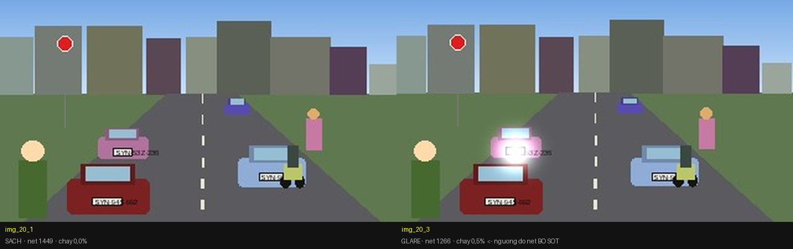
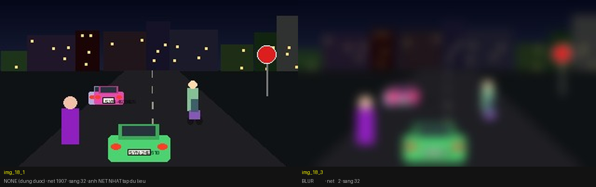

# Hai mẫu dữ liệu khó — T02

Data & Provenance · đo trên `reports/internal_labels_t02_final.csv` (56 ảnh `dev`).

Baseline mà `docs/tracks/T02.md` quy định là **một ngưỡng Laplacian toàn ảnh**.
Đặt ngưỡng ở 777 — điểm tách `blur`/`none` trong bộ nhãn — rồi đối chiếu:

```
bắt đúng 30   báo nhầm 0   BỎ SÓT 4   đúng bỏ qua 22
recall = 0,882      precision = 1,000
```

Không có ảnh sạch nào bị báo nhầm. Toàn bộ sai sót là **bỏ sót**, và cả 4 ảnh bị
bỏ sót đều **nét hơn phần lớn ảnh sạch**:

| Ảnh | Nhãn | Độ nét | Cháy sáng | Vì sao ngưỡng độ nét bó tay |
|---|---|---:|---:|---|
| `img_20_3` | glare | 1266 | 0,5% | Ảnh nét, lỗi nằm ở một đốm cháy nhỏ |
| `img_14_3` | compression | 960 | 0,1% | Vỡ khối tạo cạnh giả, làm **tăng** độ nét |
| `img_02_2` | glare | 950 | 0,5% | Như trên |
| `img_22_3` | glare | 873 | 1,0% | Như trên |

---

## Mẫu khó 1 — Glare cục bộ trên ảnh nét



`img_20_3` có độ nét **1266**, cao hơn trung vị ảnh sạch (1103). Mọi ngưỡng độ nét
đủ thấp để bắt nó sẽ quét sạch gần hết tập dữ liệu. Phần hỏng chỉ chiếm **0,5%
diện tích** — một đốm cháy trắng, nhưng rơi đúng vào vùng xe và biển số.

Đây là failure mode số 2 trong `docs/tracks/T02.md` mục 5: *"ảnh nét nhưng vùng
biển số cháy sáng (glare cục bộ) bị bỏ qua"*.

**Hệ quả cho thuật toán:** một đặc trưng toàn ảnh không bao giờ bắt được lỗi cục
bộ nhỏ như vậy. Cần `saturated_fraction` như một tín hiệu **riêng**, cộng thêm
được là tốt — nhưng ngưỡng phải rất thấp: ba ảnh glare trong `dev` chỉ có
0,5% · 0,5% · 1,0% diện tích cháy, trong khi ảnh sạch là 0,0%. Khoảng cách tuy
nhỏ nhưng tách bạch, nên một ngưỡng quanh 0,2% là đủ.

---

## Mẫu khó 2 — Ảnh đêm dùng được



`img_18_1` chụp ban đêm, độ sáng trung bình **32/255**, thuộc nhóm tối nhất tập
dữ liệu. Nhưng nó có độ nét **1907 — cao nhất trong cả 96 ảnh**, nội dung nhìn rõ,
biển số đọc được. Nhãn: `none`.

Bất kỳ quy tắc nào dạng "tối thì loại" đều giết ảnh này. Mà nhóm ảnh đêm không
nhỏ: trong `dev` có 7 ảnh `light != day` được gán `none`, chiếm gần **một phần ba**
số ảnh sạch.

Đây là failure mode số 1 trong handout: *"ảnh ban đêm hữu ích bị loại hết"*.

**Hệ quả cho thuật toán:** độ sáng tuyệt đối không phải tín hiệu lỗi. Ảnh `dark`
thật trong bộ nhãn có `dark_fraction` từ 31% đến 65%, còn `img_18_1` chỉ 8%.
Dùng **tỷ lệ pixel sát đen** chứ đừng dùng độ sáng trung bình.

---

## Một kỳ vọng của handout không đúng với fixture này

Failure mode số 3 trong handout là *"camera có quang học mềm hơn (`cam_B`) bị báo
nhầm"*. Đo trên bộ nhãn này thì **không xảy ra**: ngưỡng toàn cục cho precision
1,000, không báo nhầm ảnh `cam_B` nào.

Lý do: `cam_B` không thực sự mềm hơn. So biến thể **nét nhất của mỗi cảnh** —
xấp xỉ bản sạch của cảnh đó — thì trung vị `cam_A` là 1121 còn `cam_B` là **1418**.
Con số "`cam_B` mềm gấp 4 lần" mà một bản nháp trước đó của tài liệu này nêu là
trung vị trên **toàn bộ** ảnh, và nó thấp chỉ vì các cảnh `cam_B` trong `dev` có
nhiều biến thể bị làm hỏng hơn (3 hỏng trên 4, so với 2 trên 4 ở `cam_A`).

Vẫn nên chuẩn hoá theo `camera_id` để phòng, nhưng **đừng dựa vào bẫy này để giải
thích kết quả** — ở fixture này nó không có thật.

---

## Tóm lại cho người viết `features.py` / `scoring.py`

1. Độ nét một mình đạt recall 0,882. Phần còn thiếu **toàn bộ** nằm ở `glare` và
   `compression` trên ảnh nét — thêm feature mới ăn điểm được, chỉnh ngưỡng độ nét
   thì không.
2. `saturated_fraction` ngưỡng quanh 0,2% bắt được cả ba ảnh glare.
3. Đừng dùng độ sáng trung bình để phát hiện `dark`; dùng tỷ lệ pixel sát đen.
4. `compression` là loại khó nhất — vỡ khối làm **tăng** độ nét. Cần đo riêng,
   ví dụ năng lượng tại biên khối 8×8 của JPEG.
